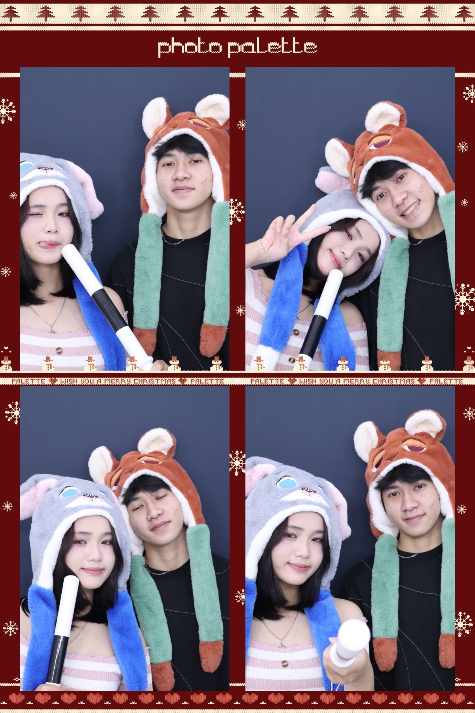
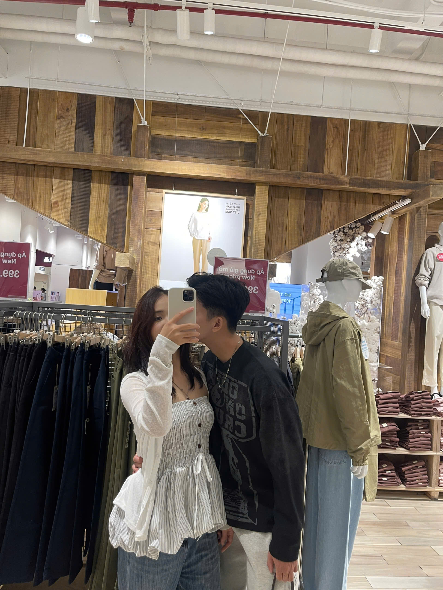

# Mười tháng bên em

Một lá thư một trang, gửi Quỳnh Anh nhân dịp mười tháng bên nhau.

Thiết kế đi theo hướng **“cả trang là một lá thư”**: giấy ấm, mực đậm, một dải sáp đỏ, tem thư và những con số đếm ngược. Trang mở bằng một lá thư niêm phong; bấm vào thư mới vào nội dung. Nhạc chỉ phát sau khi mở thư, video không tự phát, không build — toàn bộ trang nằm trong một file `index.html`.

---

## 1. Xem thử

Mở trực tiếp `index.html` bằng trình duyệt là xem được.

Nếu ảnh, video hoặc nhạc không hiện đúng, chạy một server nhỏ tại thư mục này:

```bash
cd QuynhAnh
python3 -m http.server 8000
```

Rồi mở http://localhost:8000

> Trang dùng Google Fonts (Newsreader + Be Vietnam Pro) nên cần internet để hiển thị đúng font. Ảnh, video và nhạc là file local.

### Mở lá thư

Lần đầu mở trong mỗi tab, trang hiện một lá thư niêm phong thay cho nội dung. Bấm vào bất kỳ đâu trên lá thư để mở.

- Trình duyệt nhớ trạng thái bằng `sessionStorage` (khóa `qa-letter-opened`). Mở tab mới sẽ thấy lại lá thư; tải lại tab cũ thì vào thẳng nội dung.
- Thêm `?letter=1` vào URL để xem lại lá thư bất cứ lúc nào, ví dụ `index.html?letter=1`.
- Thêm `?letter=0` để bỏ qua lá thư, hữu ích khi chụp màn hình hoặc kiểm tra phần nội dung.
- Nếu bật **giảm chuyển động** trong hệ điều hành, lá thư vẫn hiện nhưng mở ngay, không có hiệu ứng tim bay.
- Nếu JavaScript bị tắt, lá thư tự ẩn và trang vẫn mở bình thường. Phần nội dung do JavaScript sinh ra (kỷ niệm, album, video, thư, lời hứa) sẽ không có; đây là giới hạn có sẵn của trang một file.

### Tim bay khi cuộn

Mỗi vùng nội dung (chuyện, ảnh, thư, đếm ngược, lời hứa, lời kết) có một đợt tim giấy khi lần đầu lọt vào khung nhìn. Tim được làm to hơn để nhìn rõ trên cả điện thoại; không lặp lại khi cuộn qua lại trong cùng một lượt xem, và tự biến mất sau khi bay xong.

- Màu tim đổi theo nền: sáp đỏ trên giấy, giấy ấm trên nền mực, kem trên nền đỏ.
- Tim chỉ là trang trí, không chặn click hay bàn phím và tự tắt khi bật giảm chuyển động.
- Không cần thêm file hay thư viện nào.

### Tiến trình đọc và mục lục thư

- Một dải sáp đỏ mảnh ở mép trên chạy theo vị trí cuộn, giúp biết mình đang ở đâu trong trang.
- Các tiêu đề mục chính (Chuyện, Ảnh, Video, Lá thư) có một gạch sáp nhỏ hiện ra khi lọt vào khung nhìn; nội dung bên dưới hiện chậm hơn một nhịp để mắt bám theo.
- Ở lá thư, cột trái có mục lục 5 chương và dính theo màn hình trên desktop. Chương đang đọc có dấu chấm sáp và chữ đậm; bấm vào một dòng để nhảy tới chương đó. Trên điện thoại, mục lục được ẩn để không chiếm chỗ.
- Từng chương thư tự hiện khi cuộn tới, thay vì cả lá thư hiện một lần.
- Khi bật giảm chuyển động, phần chuyển động của chữ được tắt; thanh tiến trình và mục lục vẫn hoạt động như chỉ báo. Không hiệu ứng nào chặn click hay bàn phím.

---

## 2. Thay nội dung của hai bạn

Mở `index.html`, tìm đoạn:

```js
const CONFIG = {
  herName: "Quỳnh Anh",
  yourName: "Lâm",
  startDate: "2025-12-24",
  ...
};
```

Các trường chính:

| Trường | Ý nghĩa |
|---|---|
| `herName` | Tên người ấy. Tự thay vào lời chào, footer, tiêu đề tab. |
| `yourName` | Tên/gọi của bạn. Tự thay vào chữ ký và footer. |
| `startDate` | Ngày bắt đầu, dạng `"2025-12-24"`. Dùng để tính số ngày bên nhau và đếm ngược. |
| `heroPhotos` | Danh sách ảnh nền ở khung phải của hero. Ảnh đầu tiên hiện trước; các ảnh sau chuyển chậm sau mỗi 7 giây. |
| `memories` | Các mốc kỷ niệm: `date`, `title`, `text`. Ngày nên viết dạng `"2026-03-08"`. |
| `gallery` | Album ảnh: chỉ cần `src`. Gallery hiện không hiển thị caption/ngày. Trang không tự quét thư mục; ảnh mới phải được thêm vào đây. |
| `videos` | Danh sách video: `src`, `poster`, `caption`, `date`; có thể thêm `type` nếu file không phải `.mp4`. |
| `letter` | Các phần của lá thư: `heading` và `paragraphs`. Mỗi phần tử trong `paragraphs` là một đoạn văn. |
| `promises` | Danh sách những điều muốn làm cùng nhau. |
| `music` | Đường dẫn file nhạc; hiện dùng file MP3 trong `music/`. Để `""` nếu không muốn hiện nút nhạc. |

Trang đang kể bốn mốc: `07.12.2025` (lần đầu gặp), `12.01.2026` (sinh nhật), `27.03.2026` (hai bé mèo) và `30.04.2026` (khoảng thời gian khó khăn). `startDate` vẫn là `"2025-12-24"` để tính số ngày bên nhau và đếm ngược; `07.12.2025` chỉ là kỷ niệm lần đầu gặp. Nếu muốn tính từ ngày gặp đầu tiên, đổi `startDate` thành `"2025-12-07"`.

### Những câu cố định

Một vài câu chữ nằm trực tiếp trong HTML để giữ nhịp thiết kế. Nếu muốn đổi, sửa ngay trong `index.html`:

- Tiêu đề trên lá thư mở đầu và tiêu đề lớn: `Mười tháng<br>bên em`
- Lời mời trên lá thư: `Một lá thư nhỏ, mở ra khi em sẵn sàng.` và `Bấm để mở thư`
- Câu dưới tiêu đề: `Một món quà nhỏ cho chặng đường mình đã đi qua…`
- Câu cuối hero: `Cảm ơn em vì đã ở lại.`
- Lời dẫn các mục: `Chuyện của mình`, `Những tấm ảnh`, `Vài đoạn ngắn mình muốn giữ lại. Bấm play để xem.`, `Những điều mình sẽ làm`
- Tiêu đề mục video: `Những thước phim`
- Câu kết và tấm thiệp trả lời: `Anh không biết tương lai sẽ mang đến…`, `Một năm nữa nhé`
- Bưu thiếp cuối trang: `Anh thương em.` và `Cảm ơn em đã ở đây, cùng anh, qua những ngày tháng này.`

Nếu đổi mốc kỷ niệm (ví dụ 11 tháng), nhớ sửa cả tiêu đề lớn lẫn câu dưới tiêu đề.

### Đếm ngược

Đếm ngược tự tìm ngày kỷ niệm tiếp theo dựa trên `startDate`:

- Trước 24.12.2026: hiện `Tới 1 năm`.
- Đúng 24.12.2026: hiện `Hôm nay tròn 1 năm`.
- Sau đó: tự chuyển sang `Tới 2 năm`, rồi `Tới 3 năm`…

Không cần sửa tay khi sang năm mới.

---

## 3. Ảnh và video

### Album ảnh

Bỏ ảnh vào thư mục `images/`. Tên file không bắt buộc là `01.jpg`; có thể giữ nguyên tên gốc.

Mở `CONFIG.gallery`, mỗi ảnh là một dòng:

```js
gallery: [
  { src: "images/ten-file.jpg" }
]
```

- **Trang tĩnh không tự quét thư mục.** Nếu chỉ copy ảnh vào `images/` mà không thêm vào `CONFIG.gallery`, ảnh sẽ không hiện.
- Album hiện dùng toàn bộ 21 ảnh có sẵn trong `images/`, không caption; muốn bớt thì xóa dòng tương ứng, muốn thêm thì thêm dòng mới với đúng tên file.
- Ảnh được crop theo khung dọc **4:5**. Nên dùng ảnh ngang hoặc dọc có chủ thể ở giữa.
- Kích thước khoảng 1200–1600px là đủ nét mà vẫn nhẹ.
- Có thể dùng `.jpg`, `.png` hoặc `.webp`; chỉ cần sửa đuôi trong `src`.
- Album tự chia 4 cột trên desktop, 2 cột trên mobile.
- Ảnh thiếu sẽ hiện khung giấy “Một khung hình đang chờ” thay vì ảnh vỡ.
- Bấm vào ảnh để mở lightbox. Dùng nút `Trước` / `Sau`, phím `←` `→`, `Esc` để đóng, hoặc vuốt trên điện thoại.

### Video

Bỏ video vào thư mục `videos/`, đặt tên:

```text
01.mp4
02.mp4
```

Rồi mở `CONFIG.videos` và sửa `caption` / `date` cho khớp. Nếu tên file khác, sửa `src`.

```js
videos: [
  {
    src: "videos/01.mp4",
    poster: "images/ten-file.jpg",
    caption: "Một đoạn ngắn",
    date: "2026"
  }
]
```

- Video **không tự phát**. Người xem bấm nút play trên trình duyệt.
- Khung video theo tỉ lệ **16:9**; tự chia 2 cột trên desktop và 1 cột trên mobile.
- `poster` là ảnh hiện trước khi video chạy; có thể để `""` nếu không cần.
- Nên dùng `.mp4` (H.264 + AAC) để chạy trên nhiều máy nhất. `.webm` cũng được; trang tự nhận theo đuôi file, hoặc thêm `type: "video/webm"`.
- Nếu chưa có file, khung hiện “Một thước phim đang chờ” thay vì video lỗi. Nếu đã thêm file mà khung vẫn đứng yên, kiểm tra lại tên file và `src`.
- Nên nén video khoảng 1080p, dưới 20–30 MB mỗi clip để trang mở nhanh.
- Hướng dẫn ngắn cũng có trong `videos/README.md`.

### Nền trang

Ảnh nền dùng chung cho toàn trang nằm trong `.page-bg` ở đầu `<body>`:

```html
<div class="page-bg" aria-hidden="true">
  <div class="page-bg-track" id="pageBgTrack">
    
    
  </div>
</div>
```

- Hai ảnh xếp dọc, mỗi ảnh cao một viewport. Khi cuộn, track trượt chậm hơn nội dung; ảnh thứ hai xuất hiện từ phía dưới.
- Đổi `src` hoặc thêm/bớt ảnh trong track nếu muốn.
- Ảnh được làm mờ, tối và phủ một lớp gradient; các section giấy/đỏ có nền trong suốt nhẹ để ảnh xuyên qua.
- Nên dùng ảnh có độ phân giải vừa phải (khoảng 1600–2000px) để trang nhẹ.
- Ảnh trong hero/gallery vẫn hiển thị đục bình thường.

### Ảnh nền hero

`CONFIG.heroPhotos` đang dùng bốn ảnh cá nhân trong `images/`. Muốn thay:

1. Thêm ảnh vào `assets/` (hoặc `images/`).
2. Sửa `CONFIG.heroPhotos` thành danh sách đường dẫn mới.
3. Nếu ảnh bị crop lệch chủ thể, chỉnh `object-position` cho `.hero-photo img:nth-child(...)` trong CSS.

Nên chọn ảnh ngang, tối giản, có một điểm nhấn rõ — khung bên phải cao và hẹp.

---

## 4. Nhạc

Bỏ file nhạc vào `music/` và trỏ `CONFIG.music` đúng tên file. Hiện trang dùng:

```js
music: "music/JVKE_-_oh_to_be_loved_(Official_Lyric_Video).mp3"
```

- Nhạc bắt đầu khi bấm mở bức thư; nhạc lặp lại.
- Nút `Nhạc` ở góc phải dùng để bật/tắt sau đó.
- Nếu mở trang bằng `?letter=0` (bỏ qua bìa), nhạc không tự phát; bấm nút để bật.
- Âm lượng mặc định 0.38; muốn đổi, tìm `audio.volume = 0.38` trong phần JavaScript.
- Nên dùng file nhẹ để trang mở nhanh.

---

## 5. Ảnh stationery và bản quyền

Các ảnh trong `assets/` là ảnh tư liệu có giấy phép mở, dùng để tạo không khí “thư tay”, **không phải ảnh kỷ niệm của hai bạn**. Một vài file chỉ còn là bản lưu, không hiển thị trên trang:

| File | Nguồn / tác giả | Giấy phép |
|---|---|---|
| `sealing-wax-on-letters.jpg` | “Sealing wax on letters” — Simon A. Eugster, [Wikimedia Commons](https://commons.wikimedia.org/w/index.php?curid=52421294) | CC BY-SA 3.0 |
| `letter-1845.jpg` | Thư của Fanny Appleton Longfellow, 1845 — [Wikimedia Commons](https://commons.wikimedia.org/wiki/File:Frances_(Appleton)_Longfellow_to_Anne_Longfellow_Pierce,_17_January_1845_(a058c4e7-5112-4e21-87e7-febb485779e7).jpg) — bản lưu, không còn hiển thị trên trang | Public domain |
| `love-letter-1906.jpg` | “Love Letter” — Kajita Hanko, 1906 — [The Met](https://www.metmuseum.org/art/collection/search/55392) | Public domain |
| `fountain-pen.webp` | Fountain pen — [rawpixel](https://www.rawpixel.com/image/6034849/fountain-pen-free-public-domain-cc0-ph) | CC0 |
| `letter-stamp.jpg` | Bản cắt từ `fountain-pen.webp` — bản lưu, không còn hiển thị trên trang | CC0 |
| `postcard-stamp.jpg` | Mặt sau bì thư Hà Lan, 1932 — [Wikimedia Commons](https://commons.wikimedia.org/wiki/File:Netherlands_1932-1-21_money_letter_NVPH_193_SF_reverse.jpg) | Public domain |

`assets/credits.json` lưu thông tin nguồn chi tiết.

- Dòng credit ở footer đã được gỡ theo yêu cầu. Thông tin nguồn vẫn được lưu trong bảng trên, `assets/credits.json` và README này; nếu đưa trang lên công khai, ảnh sáp đỏ CC BY-SA 3.0 vẫn cần được ghi công ở một nơi phù hợp.
- Hai ảnh `letter-1845.jpg` và `letter-stamp.jpg` đã được gỡ khỏi giao diện và chỉ còn là bản lưu trong `assets/`.
- Ảnh sáp đỏ là CC BY-SA 3.0: nếu chỉnh sửa/recolor rồi phát hành lại, ảnh phái sinh cũng phải chia sẻ theo CC BY-SA 3.0.
- Nếu thay bằng ảnh khác, cập nhật bảng nguồn ở trên và `assets/credits.json` cho khớp.
- Ảnh gốc chưa dùng (`frances-...jpg`, `love-letter-kesobumi.jpg`, `netherlands-...jpg`) chỉ là bản lưu; có thể xóa nếu muốn nhẹ thư mục.

---

## 6. Cấu trúc thư mục

```text
QuynhAnh/
├── index.html          # toàn bộ trang, CSS và JavaScript
├── README.md
├── images/             # ảnh kỷ niệm + README
├── videos/             # video kỷ niệm (01.mp4 … 02.mp4) + README
├── music/              # nhạc nền (file .mp3 hiện tại)
└── assets/             # ảnh stationery, tem thư, credits.json
```

Không có bước build, không cần npm, không có framework.

---

## 7. Đưa lên mạng

Trang là file tĩnh, có thể đưa lên:

- **GitHub Pages**: đẩy cả thư mục lên repo, bật Pages.
- **Netlify / Vercel**: kéo thả thư mục, không cần build command.
- **Máy cá nhân**: dùng `python3 -m http.server`.

Giữ nguyên cấu trúc thư mục và đường dẫn tương đối.

> Đây là lá thư riêng. Nếu đưa lên GitHub Pages hoặc một URL công khai, ai có link đều đọc được. Nếu muốn giữ riêng tư, hãy để trang ở máy hoặc dùng một URL không chia sẻ.

---

## 8. Đã kiểm tra

- Bản audit gần nhất có từ trước lần gỡ ảnh thư 1845 / tem bút máy, thêm hiệu ứng cuộn và thêm mục Video; các kết quả dưới đây giữ để tham khảo, phần thay đổi mới được kiểm tra thủ công.
- Audit `index.html` (có lá thư mở đầu) ở 1440 / 768 / 390px: **1 FAIL, 2 WARN**.
- FAIL `late-title`: đây là ngoại lệ có chủ đích của lá thư mở đầu. Cover cố ý phủ lên `h1` trong hơn 1,2 giây đầu; sau khi bấm mở, `h1` hiện ra và được đưa focus. Bộ kiểm tra tự động không bấm cover nên chỉ thấy màn che.
- Kiểm tra riêng phần nội dung bằng `?letter=0`: **0 FAIL**, 1 WARN (`no-footage`). Như vậy các lỗi còn lại đến từ cover, không phải từ bố cục bên dưới.
- WARN `no-footage`: bản audit cũ có từ trước khi thêm mục Video. Hiện trang đã có mục `#videos` với khung 16:9 và nút play của trình duyệt, nhưng chưa có clip thật nên các khung hiện placeholder.
- WARN `pinned-over-picture`: bộ kiểm tra cuộn trang trong lúc cover còn cố định. Khi dùng thật, trang bị khóa cuộn cho đến khi mở thư, và `h1` nằm trong cột giấy riêng, không đè lên ảnh.
- Đã kiểm tra thêm: cover + focus + `sessionStorage`, `?letter=1`, `?letter=0`, reduced-motion, không-JS, tim bay một lần mỗi vùng, lightbox (chuột + bàn phím), đếm ngược, nút gửi, nhạc có/không có file, không tràn ngang ở 390px, không lỗi JavaScript.
- Sau khi thay nội dung: kiểm tra lại ở 1440px và 390px, có đủ 4 mốc, 5 chương và 24 đoạn thư; không tràn ngang; cover, tim bay, lightbox, đếm ngược, nút gửi và trạng thái nhạc vẫn hoạt động; không lỗi JavaScript.
- Sau khi gỡ ảnh thư 1845 và tem bút máy: không còn phần tử `.plate` / `.stamp`, ảnh cũ không được tải; thanh tiến trình đọc chạy từ 0 đến 1; mục lục 5 chương dính trên desktop và đổi đúng chương khi cuộn hoặc bấm; từng chương thư hiện dần; mobile ẩn mục lục; không tràn ngang ở 1440px và 390px; cover, lightbox, nhạc và nút gửi vẫn chạy; không lỗi JavaScript.
- Sau khi thêm mục Video và gỡ dòng credit footer: có 2 khung 16:9 với `controls`, `playsinline`, `preload="metadata"` và không có `autoplay`; khung thiếu file hiện placeholder đúng; desktop 2 cột, mobile 1 cột; không tràn ngang ở 1440 / 820 / 390px; footer không còn `.credits`; cover, album, lightbox, thư, nhạc và nút gửi vẫn chạy; không lỗi JavaScript.
- Sau khi nối gallery với ảnh thật: ảnh trong `CONFIG.gallery` tải đúng, không còn khung chờ; chữ thư vẫn đọc được; không tràn ngang ở 1440px và 390px; không lỗi JavaScript.
- Sau khi chuyển sang nền chung và thêm nhạc: ảnh nền `images/ac6520548572052c5c63.jpg` tải đúng, phủ toàn viewport và xuyên qua các section giấy/đỏ; nút mở thư phát file MP3, lặp lại và nút `Nhạc` tắt được; không tràn ngang ở 1440px và 390px; không lỗi JavaScript.
- Sau khi thêm ảnh nền thứ hai và hiệu ứng cuộn: hai ảnh trong `.page-bg-track` tải đúng, track cao hai viewport và dịch đủ một ảnh khi cuộn hết trang; tim bay quá chiều cao màn hình và được dọn sau animation; reduced-motion không chạy parallax; nhạc và cover vẫn hoạt động; không tràn ngang ở 1440px và 390px; không lỗi JavaScript.
- Sau khi làm nền rõ hơn và thêm toàn bộ ảnh vào gallery: ảnh nền dùng blur 5px, opacity .9; nền giấy .64, nền đỏ .68; gallery có đủ 21 ảnh, không caption/ngày, tất cả tải được; lightbox ẩn thanh caption rỗng; không tràn ngang ở 1440px và 390px; nhạc, cover, tim và parallax vẫn chạy; không lỗi JavaScript.

Chúc em một ngày thật dịu dàng.
